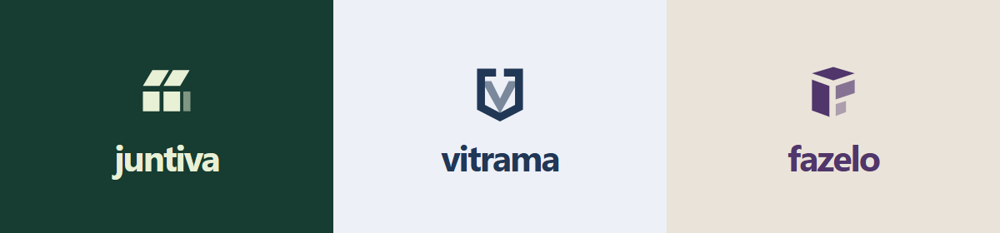

# Uma marca para a próxima fase

Propostas exploratórias para a plataforma hoje chamada FoodWeb. Nenhuma delas foi aplicada ao produto. A identidade das lojas, incluindo a Doce Lua, permanece independente da marca da plataforma.

O produto passa a reunir vitrines e operação de negócios que vendem alimentos, produtos, serviços, personalizados, impressão 3D e aluguel. Eventos e combos aproximam parceiros, mas continuam opcionais. A marca deve comportar esses usos sem fazer o comprador pensar que está em um aplicativo exclusivo de delivery.

## Opções de nome

| Nome | Ideia | Ponto forte | Ponto de atenção |
| --- | --- | --- | --- |
| **Juntiva** | Juntar negócios, itens e oportunidades. | Curto, pronunciável e ligado à parceria entre lojas; permite crescer além de um ramo. | A comunicação precisa deixar claro que cada loja mantém sua identidade e operação. |
| **Vitrama** | Vitrine + trama: cada negócio faz parte de uma composição maior. | Equilibra exposição de produtos e conexão; funciona para lojas e serviços. | O significado não é imediato; precisa de um descritor no início. |
| **Compora** | Compor uma oferta, um evento ou uma operação. | Relação direta com combos e personalização, sem limitar o catálogo. | Pode ser confundido na fala com “compra”; testar a pronúncia com lojistas. |
| **Fazelo** | Fazer acontecer: da ideia ao produto e à venda. | Próximo de criadores, impressão 3D e pequenos negócios. | Pode sugerir uma ferramenta de produção; acompanhar de um descritor comercial. |
| **Vendeia** | Uma forma leve de falar de venda e movimento comercial. | Intenção de venda clara, fácil de associar à vitrine. | Tom mais informal; avaliar se combina com locadoras e empresas de serviços. |

## Recomendação

**Juntiva** é a direção recomendada para uma marca ampla. Aproxima o novo recurso de parceria sem restringir o negócio a comida, eventos ou fabricação. A palavra permite uma linguagem simples: “Minha loja na Juntiva”, “Painel Juntiva” e “Pedido da sua loja”.

Descritor inicial: **Vitrine e gestão para o seu negócio.**

Assinatura de campanha: **Seu negócio. Novas possibilidades.**

Mensagem comercial: “Venda seus produtos e serviços com a sua identidade. Organize a operação e, quando fizer sentido, crie novas ofertas com parceiros.”

**Vitrama** é a alternativa se a prioridade for uma imagem mais focada em catálogo e exposição. **Fazelo** é a alternativa se o público principal se tornar o de criadores e produção personalizada.

## Três direções de logo

As propostas estão na [prancha visual](brand-directions.html), feita em HTML e SVG, sem fontes, bibliotecas ou imagens externas.

1. **Juntiva / Encontro de vitrines.** Dois módulos de loja que se conectam por uma abertura central. Verde profundo e lima discreto. O símbolo fala de autonomia e parceria sem usar corrente, aperto de mãos ou uma sacola genérica.
2. **Vitrama / Janela para vender.** Uma janela aberta forma um V no espaço central. Azul profundo e laranja de ação. Mais editorial, com ênfase na exposição do produto e leitura clara no painel.
3. **Fazelo / Da ideia à entrega.** Peças em ângulo compõem um F, lembrando uma peça montada ou dobrada. Violeta escuro e areia. Aproxima o produto de criação, fabricação e serviços sem usar engrenagem ou impressora como símbolo permanente.

Os três símbolos são desenhos vetoriais próprios para esta exploração. Ainda precisam de refinamento e teste de reconhecimento em tamanhos pequenos antes de uma identidade definitiva.

## Como a marca convive com cada loja

- A marca da plataforma identifica a página comercial, o cadastro e o acesso ao painel.
- Na vitrine do cliente, o nome, a logo, os produtos e a proposta da loja têm prioridade.
- O ramo ajusta vocabulário e apresentação, sem ativar módulos ou alterar preços, estoque, pagamento, entrega ou retirada.
- A Doce Lua mantém sua identidade visual própria. Uma mudança da marca da plataforma não substitui o tema da loja.
- O nome técnico `food_*`, URLs existentes e integrações podem permanecer durante uma transição de marca, preservando compatibilidade.

## Antes de escolher

Não foi feita pesquisa de disponibilidade, registro, domínio ou redes sociais. Os nomes são candidatos criativos, sem garantia de exclusividade.

Antes de adotar um nome, pesquisar marcas no INPI e negócios com grafia ou pronúncia semelhantes, conferir domínio e perfis, e testar compreensão e escrita com alguns lojistas. Depois da escolha, finalizar arquivos monocromáticos e coloridos, favicon, tamanhos mínimos e contraste. A troca no produto deve ser feita em uma etapa separada, com redirecionamentos e comunicação aos usuários quando necessário.
